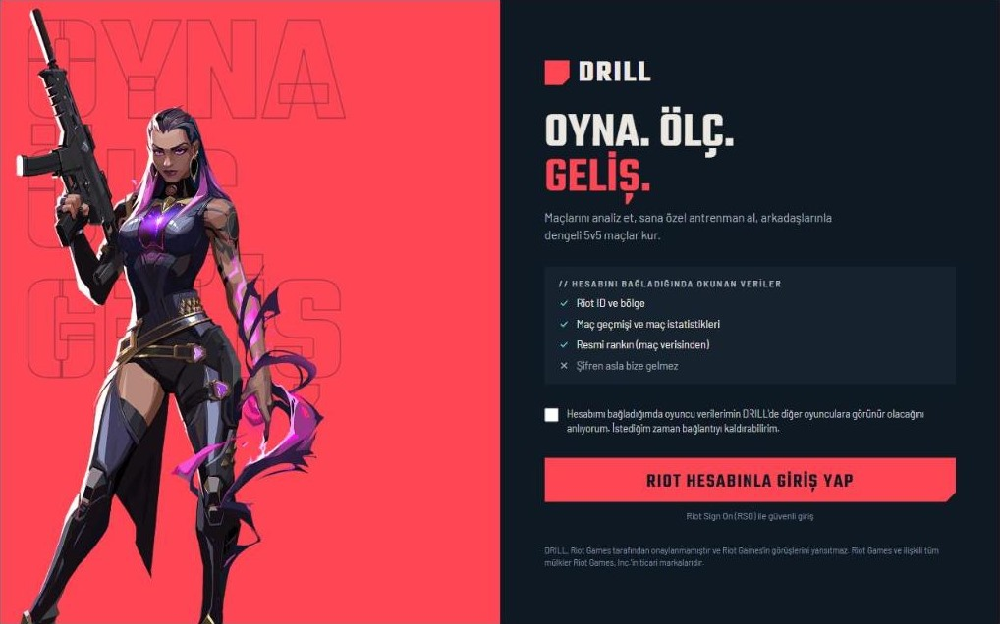
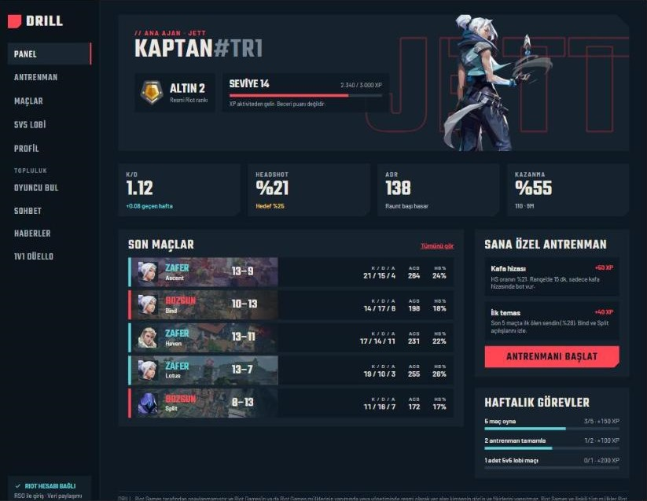
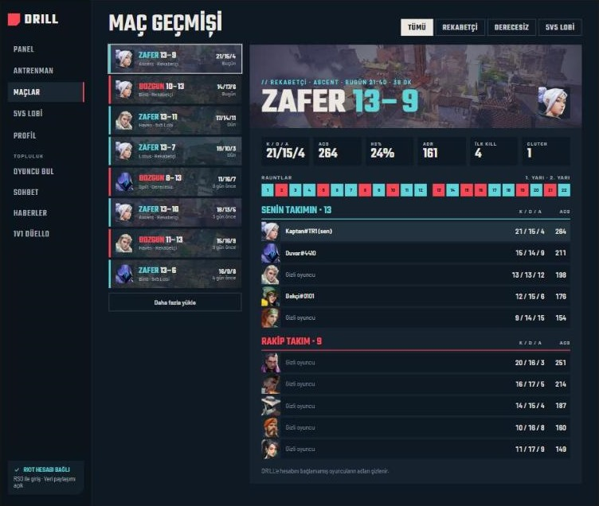
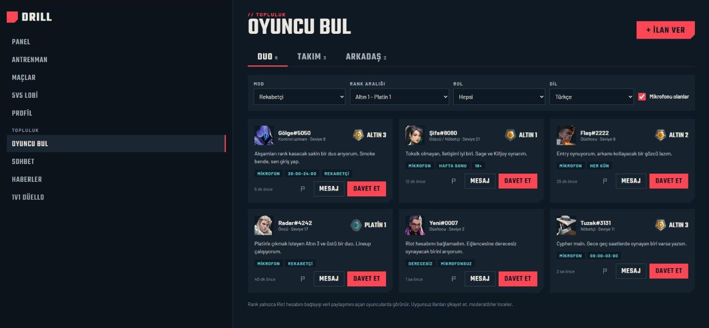
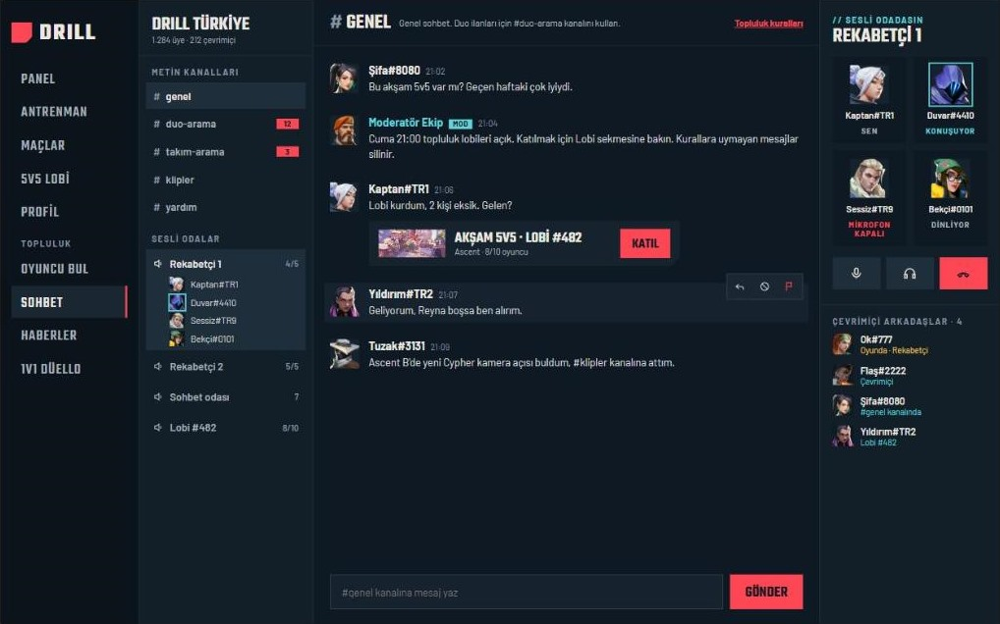
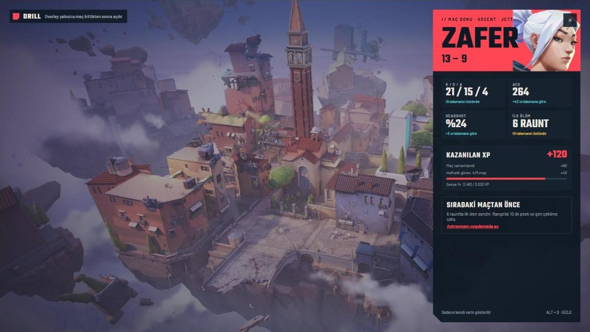

# DRILL

[](https://github.com/motioonofficial/valorant-plus/actions/workflows/ci.yml)

🇬🇧 English · 🇹🇷 [Türkçe](README.tr.md)

An open-source VALORANT companion app: match stats, personal training, activity-based XP and a community layer (finding players, chat, custom 5v5 lobbies). The app UI is in Turkish for now; the code and docs are in English.

> DRILL isn't endorsed by Riot Games and doesn't reflect the views or opinions of Riot Games or anyone officially involved in producing or managing Riot Games properties. Riot Games, and all associated properties are trademarks or registered trademarks of Riot Games, Inc.

## Status

Early and in active development. **Not approved by Riot yet**: the production key / RSO application is the next step, so real match sync is untested end to end.

| Works today | Designed, not coded yet |
|---|---|
| Server: RSO login flow, match sync, stats, activity XP, training, match history + detail, LFG posts + reports | Profile, chat, news, 1v1, 5v5 lobbies |
| Desktop: splash, login with opt-in, panel, training, match history, LFG | Voice rooms, in-game overlays |
| Local dev without a Riot key (`DEV_LOGIN` + sample data) | |

## Screens

> From the design prototype. Names and numbers are sample data.

| Login | Panel |
|---|---|
|  |  |
| **Match history** | **Find players (LFG)** |
|  |  |
| **Chat and voice rooms** | **In-game overlay: post-match** |
|  |  |

## Riot Developer Policy

DRILL is designed around Riot's developer policy. Contributions must keep it that way:

- **No skill rating of our own.** XP and levels come only from activity (playing, training, quests). No ELO/MMR or alternative ladder.
- **No scouting.** Opponents' (or teammates') ranks and stats are never shown before a match starts. In custom lobbies, the other team only shows an average.
- **Opt-in only.** A player's data is never shown to others unless they linked their account and enabled sharing.
- **No in-match advantage.** In-game overlays only show the player's own data before/after a match, plus voice chat.
- **No betting or gambling.** 1v1s and lobbies have no prizes.
- **The API key never ships to clients.** The Riot key lives only on the server, in `.env`.

Feedback on anything that might still conflict with the policy is very welcome.

## Structure

```
apps/server      Fastify + Prisma (PostgreSQL): RSO login, match sync, XP, LFG
apps/desktop     Electron + React: splash, login, panel, find players
packages/shared  Shared types, XP rules, rank names
```

## Getting started

Requirements: Node.js 20+. PostgreSQL does not need to be installed.

```bash
npm install

# Server config
cp apps/server/.env.example apps/server/.env
# Without a Riot key, set DEV_LOGIN=true in .env for local development.

# Database: keep this running in its own terminal (no Docker, runs inside the repo)
npm run db:local -w @drill/server
# Prefer Docker? Use this instead: docker compose up -d

npm run db:migrate                 # create tables
npm run db:seed -w @drill/server   # (optional) sample matches for the dev user
npm run dev:server                 # http://127.0.0.1:4000
npm run dev:desktop                # Electron app
```

The server listens on `127.0.0.1` only by default. On a real server set `HOST=0.0.0.0` in `.env` and put it behind a reverse proxy.

Agent, map and rank images are loaded at runtime by URL from the community-run [valorant-api.com](https://valorant-api.com); the app code contains no image files.

### Developing without a Riot key

With `DEV_LOGIN=true` in `apps/server/.env`, the login screen shows a **developer login** button that signs you in as a fake user. Match sync needs a real Riot production key; `/content` works without one. Never enable `DEV_LOGIN` on a public server.

### Riot key

Register the product on the [Riot Developer Portal](https://developer.riotgames.com/) and apply for a production key and an RSO client. RSO redirect URI: `<PUBLIC_URL>/auth/rso/callback`.

## Commands

| Command | What it does |
|---|---|
| `npm test` | Unit tests (vitest) |
| `npm run typecheck` | TypeScript check across all packages |
| `npm run db:migrate` | Prisma migration |

## Roadmap

- **Phase 1:** RSO login, panel, match history, XP and quests, training, find players ← now
- **Phase 2:** Chat, news, friends, moderation panel
- **Phase 3:** Custom 5v5 and 1v1 lobbies, voice rooms (LiveKit), in-game overlays

## Contributing

Contributions are welcome! Read [CONTRIBUTING.md](CONTRIBUTING.md) first, especially the Riot policy section.

## License

[MIT](LICENSE). The app code contains no Riot Games image files (agents, maps, rank icons); they're loaded by URL at runtime. Game art visible in the promotional screenshots under `docs/screenshots/` belongs to Riot Games and is not covered by the MIT license.
